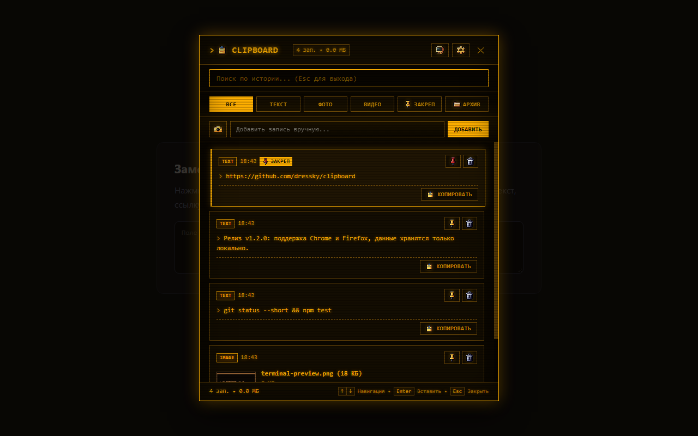
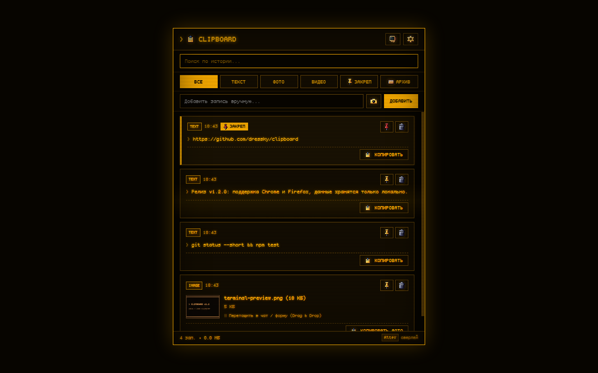

# Clipboard - Local & Private

Локальный менеджер буфера обмена для Chrome и Firefox в формате Manifest V3. Сохраняет текст, ссылки, изображения и видео прямо в браузере без серверов, аккаунтов и телеметрии.

## Возможности

- Локальная база `IndexedDB` (`LocalClipboardDB`) с запросом `navigator.storage.persist()` — данные остаются только на вашем устройстве.
- Автоматический захват текста при копировании (`Ctrl+C`), сохранение текста, ссылок, изображений и видео через контекстное меню, а также загрузка файлов перетаскиванием.
- Плавающая панель по `Alt+V` поверх любой страницы в изолированном Shadow DOM (работает на английской и русской раскладках).
- Быстрый поиск и фильтры по категориям: `Текст`, `Ссылки`, `Фото`, `Видео`, `Закрепленные` и `Архив`.
- Закрепление важных записей: закреплённые элементы не переносятся в архив и не удаляются при очистке по сроку хранения.
- Сжатие старых незакреплённых изображений в WebP и ограничение активной ленты с переносом в архив.
- Блокировка захвата полей ввода пароля (`input[type="password"]`) и настраиваемый список исключений для доменов и поддоменов.
- Экспорт и импорт резервной копии в локальный JSON-файл.

## Скриншоты





## Поддерживаемые браузеры

- **Chrome / Chromium 114+**: Edge, Brave, Opera, Vivaldi, Яндекс Браузер (поддерживаются всплывающее окно, плавающая панель, боковая панель `sidePanel` и отдельное окно).
- **Firefox 140+**: всплывающее окно, плавающая панель и отдельное окно (так как в Firefox нет `chrome.sidePanel`, расширение использует Event Page и автоматически скрывает недоступные пункты боковой панели).

## Установка из исходников

### Chrome и браузеры на Chromium

1. Склонируйте репозиторий:
   ```bash
   git clone https://github.com/dressky/clipboard.git
   cd clipboard
   ```
2. Откройте `chrome://extensions` и включите **Режим разработчика**.
3. Нажмите **Загрузить распакованное расширение** и выберите папку репозитория.

### Firefox

1. Соберите пакеты с помощью Node.js (`>= 18`):
   ```bash
   npm run package
   ```
2. Откройте `about:debugging#/runtime/this-firefox`.
3. Нажмите **Загрузить временное дополнение…** и выберите `dist/clipboard-firefox-v1.2.0.zip` (для постоянной установки используйте подписанный `.xpi` из [Releases](https://github.com/dressky/clipboard/releases) или страницу в Firefox Add-ons).

## Сборка и тестирование

Требуется только Node.js `>= 18` (runtime-зависимостей нет):

```bash
# Запустить все автотесты (манифест, ZIP-пакеты, IndexedDB/архивация, жизненный цикл медиа, Chromium E2E)
npm test

# Собрать ZIP-архивы для Chrome Web Store и Firefox AMO в ./dist/
npm run package
```

Скрипт `tools/package-stores.js` собирает два чистых архива:
- `dist/clipboard-chrome-v1.2.0.zip` — сборка для Chrome Web Store.
- `dist/clipboard-firefox-v1.2.0.zip` — сборка для Firefox AMO с секцией `browser_specific_settings.gecko`, `background.scripts` и без Chrome-специфичных ключей (`sidePanel`, `minimum_chrome_version`).

## Структура проекта

```text
├── manifest.json              # Базовый Manifest V3 (Chrome)
├── background/
│   └── service-worker.js      # Контекстное меню, сохранение медиа, маршрутизация команд
├── content/
│   └── content-script.js      # Плавающая панель Alt+V (Shadow DOM) и автозахват копирования
├── lib/
│   └── db.js                  # Локальная база IndexedDB, архивация, WebP-сжатие, экспорт/импорт
├── ui/
│   ├── panel.html             # Интерфейс popup, side panel и отдельного окна
│   ├── panel.css
│   └── panel.js
├── icons/                     # Иконки расширения (16, 32, 48, 128 px)
├── fonts/                     # Локальные шрифты Tiny5 Mono
├── tests/                     # Автотесты (run-all.js, test-manifest.js, test-storage.js, test-images.js, test-chrome-headless.js)
├── tools/
│   └── package-stores.js      # Сборщик POSIX ZIP-архивов для Chrome и Firefox
├── PRIVACY.md                 # Политика конфиденциальности
├── CHROMEWEBSTORE.md          # Материалы для публикации в Chrome Web Store
└── FIREFOX_AMO.md             # Материалы для подачи заявки в Firefox Add-ons (AMO)
```

## Приватность

Расширение не отправляет данные на внешние серверы, не использует аналитику и не требует регистрации. Единственное сетевое обращение происходит по явному клику на пункт контекстного меню **«Сохранить картинку в Clipboard»** или **«Сохранить видео в Clipboard»**, когда файл скачивается локально в браузер. Подробности — в [PRIVACY.md](PRIVACY.md).

## Лицензия

[MIT](LICENSE)
